<h1 align="center">Pukaar</h1>

**A community issue tracker where residents confirm the fix.**

*Pukaar* means a call, a cry out. Here, a call stays on the record until the people who made it agree it was answered. A steward can say the streetlight is fixed, but only the person who reported it, or two other residents, can make that true. Nobody can quietly rewrite the history afterward, and no server holds the only copy.

Pukaar is a [Logos Basecamp](https://github.com/logos-co/logos-basecamp) app for a shared site such as a camp, a building or a neighborhood. Members report faults, follow each one on an Issue Tracker, and talk it through in the same app. Built for the Field Station civic reporting brief.

| At a glance | |
|---|---|
| Who it is for | Residents, stewards and admins of a small shared site. The sample site is Dhun Camp |
| What it replaces | The spreadsheet, group chat or paper log where whoever runs it decides what "resolved" means |
| What you can rely on | Nothing is ever deleted, and there is no server to run |
| How it syncs | Peer to peer over Logos Delivery. Every member holds a full copy. Anchors on the Logos Execution Zone (LEZ) fix the history |
| What it costs today | Nothing to run. See [What it costs](docs/install-and-run.md#what-it-costs) |
| Runs on | Logos Basecamp 0.3.1 or higher |
| Latest release | [v0.4.2](https://github.com/adysingh5711/pukaar/releases/tag/v0.4.2): `.lgx` packages for Logos Basecamp 0.3.1 |
| Demo video | To be added |

## See it

<table>
  <tr>
    <td align="center"> Issue Tracker</td>
    <td align="center"> Why not closed yet</td>
    <td align="center"> Confirm the fix</td>
  </tr>
  <tr>
    <td align="center"> History</td>
    <td align="center"> Report</td>
    <td align="center"> Profile</td>
  </tr>
  <tr>
    <td align="center"> People</td>
    <td align="center"> Places</td>
    <td align="center"> Integrity</td>
  </tr>
</table>

Each screen is explained in [Screenshots](docs/screenshots.md).

## A fault's life

Picture a tap that drips in the shared washroom of a camp.

1. A resident reports it. It lands on the Issue Tracker as open.
2. A steward acknowledges it and posts the next step and an ETA.
3. The steward fixes the tap and claims the fix, with a note. A claim is not a closure.
4. The reporter confirms, or two other residents do. The claimant never can. The reporter can always reopen.
5. Each step is a signed event in its author's own log. Nothing is deleted.

<em>A steward claims the fix. The reporter, or two other residents, turn the second key.</em>

The full story and the state diagram are in [How it works](docs/how-it-works.md#a-faults-life).

## Who does what

| Role | What they do | Limit |
|---|---|---|
| Resident | Reports faults, confirms or reopens a fix, chats and meets | Can be named by the admin, or stay pseudonymous |
| Steward | Acknowledges, updates, claims a fix with a note, closes without a fix, marks duplicates | Always named. Never confirms their own claim |
| Admin | Does what a steward does. Approves people, grants roles with a reason everyone can see, manages places | Cannot grant or change admins |
| Super admin | Grants and changes admins. At most two per site | Nobody can revoke a super admin |

The full table is in [Features and roles](docs/features.md#who-does-what).

## Talk it through

The tap is still dripping, and the reporter wants to ask the steward a question. Pukaar has private chat (one to one and in groups) and meetings for up to eight people built in. The talk about a fault stays with the site, and nobody runs a server.

<em>Each part of Pukaar sits on a Logos module.</em>

| Part | Logos module |
|---|---|
| Moving messages and event sync | `delivery_module` 0.4.0 |
| Private chat | `chat_module` 0.3.0 |
| Meeting messages | `delivery_module` plus Pukaar's own seal |
| Meeting backup | `storage_module` 3.0.2 |
| History checkpoints and backup pointer | LEZ (`pukaar_registry`) |

Usage steps, the full table and the limits are in [Features and roles](docs/features.md#talk-it-through-in-the-same-app).

## Install (v0.4.2)

Add this source in Basecamp, Package Manager: `https://raw.githubusercontent.com/adysingh5711/pukaar/main/public/install/logos-repo.json`. You can also use the [install page](https://pukaar-logos.vercel.app/), or install by hand with the release notes. The packages need Logos Basecamp 0.3.1 on a Mac with Apple silicon, or on 64-bit Linux (Intel, AMD or ARM). Intel Macs and Windows are not supported.

The full steps, network notes and profile tips are in [Install and run](docs/install-and-run.md#run-pukaar-in-basecamp). The release notes are on the [v0.4.2 release page](https://github.com/adysingh5711/pukaar/releases/tag/v0.4.2).

## Go deeper

| Document | Open it to |
|---|---|
| [How it works](docs/how-it-works.md) | See how events, sync, checkpoints and the chain registry fit together |
| [Features and roles](docs/features.md) | Know every feature, every role and the chat and meeting details |
| [Screenshots](docs/screenshots.md) | Read what each of the nine screens shows |
| [Install and run](docs/install-and-run.md) | Install Pukaar, run several profiles, upgrade or see the cost |
| [Security](docs/security.md) | Study the threat model, or confirm a signature or an anchor |
| [Developing](docs/developing.md) | Run the tests, build from source or cut a release |
| [Roadmap](docs/roadmap.md) | See what shipped and what comes next |

## License

Dual-licensed under [MIT](LICENSE-MIT) or [Apache-2.0](LICENSE-APACHE), at your option.

## Acknowledgements

Built on [Logos](https://logos.co) (Basecamp, Delivery, LEZ, SPEL and `logos-scaffold`) for the Field Station civic reporting brief.
