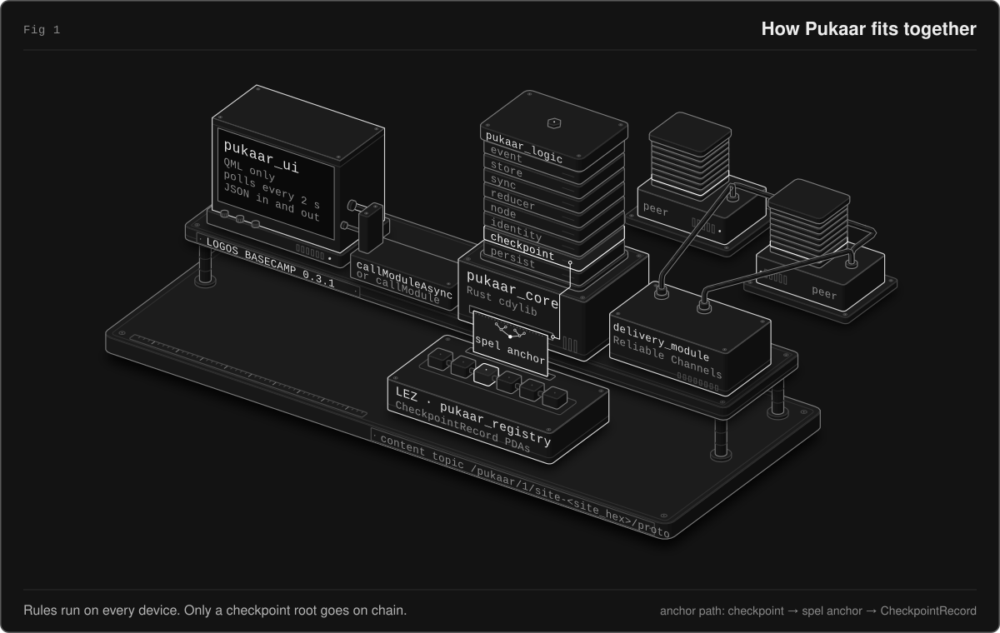

# How Pukaar works

The life of a fault, the signed event log, sync, checkpoints, the architecture and the on-chain registry, for readers who want to pull the thread. [Back to the README](../README.md).

## A fault's life

Picture a tap that drips in the shared washroom of a camp.

1. A resident files a report with a category, a line of description and a place from the site's list. It lands on the Issue Tracker as open.
2. A steward acknowledges it and posts an update with the next step and an ETA. A card that misses its target turns red, so a stalled report is visible to everyone.
3. The steward replaces the washer and claims the fix. The claim must say what was done. The card moves to "Fix claimed, awaiting confirmation" and stays in progress.
4. The reporter checks the tap. If it is dry, the reporter confirms and the report is resolved. If it is still dripping, the reporter reopens it with a reason. Two other residents can also confirm, but the steward who claimed the fix never can.
5. Each step is a signed event in its author's own log. Nothing is deleted, so the whole story stays in the history.

The same life as a state diagram:

```
 report ─▶ OPEN ─acknowledge─▶ ACKNOWLEDGED ─update─▶ IN_PROGRESS ⟲ update
             │                                              │
             └───────── claim_resolved (needs a note) ──────┴─▶ AWAITING_CONFIRMATION
                                                                     │
                     confirm: the reporter, or 2 residents, never the claimant
                                                                     ▼
                                                            CONFIRMED_RESOLVED

 OPEN, ACKNOWLEDGED or IN_PROGRESS ── close_wontfix (needs a reason) ──▶ CLOSED_WONTFIX
 any state that is not final ─────────────── mark_duplicate ───────────▶ DUPLICATE

 update (needs a note) also goes from OPEN to IN_PROGRESS.
 reopen (needs a reason): the reporter, or 2 residents. It goes from AWAITING_CONFIRMATION,
 CONFIRMED_RESOLVED, CLOSED_WONTFIX or DUPLICATE to OPEN. A retired place refuses it.
```

## Events, order and sync

Each member signs their own actions into a private log that only grows. The logs sync peer to peer, and every device computes the same board from them. Each question below opens a block with the details.

<details>
<summary>What is an event?</summary>

Each action is an ed25519-signed, postcard-encoded envelope (`v`, `site`, `author`, `seq`, `prev` hash, Lamport clock, `ts` wall clock, body) under the domain `logos:pukaar:1\0`. The decoder is strict: events are at most 4 KiB, trailing bytes are rejected, and the signature is checked before the body is decoded. The sender caps every text field at 500 B. On receipt, the decoder applies that cap only to `Report`, `LocationEdit`, `LocationRetire`, `LocationRemove` and `AdminNotice` bodies.

</details>

<details>
<summary>How does every device agree on the order?</summary>

Events apply in `(lamport, author, id)` order, so every replica computes the same board no matter what order messages arrive in. A property test replays 60 random histories in 20 shuffled delivery orders each and checks that the final states are identical. The test generates issue events only, so it does not cover notice or seal events.

</details>

<details>
<summary>How do events travel?</summary>

Live events go over `delivery_module` Reliable Channels on the content topic `/pukaar/1/site-<site_hex>/proto`. Catch-up is heads-based anti-entropy with a capped resend, not Store queries, so late joiners, restarts and LAN-only sites work without a store node. Every 60 s, each node sends its heads (the newest event of each author). Three peers answer each heads message, and one resend carries at most 200 events.

</details>

<details>
<summary>What happens when a log forks?</summary>

If one identity ever signs two different events at the same position (one person on two devices, or a cheat), every replica keeps the **same** branch: at each position the event with the lowest id wins, whatever order the copies arrive in. The losing branch is kept and saved as evidence, never applied, and the board shows a fork warning. A replica holds at most 4 events per `(author, seq)`, the winner included.

</details>

<details>
<summary>How do checkpoints fix the history?</summary>

A Merkle root (RFC 6962 style) over every author's chain head, signed by a member under `logos:pukaar:cp:1\0` and anchored with one SPEL instruction on LEZ. Anyone can recompute the root from their own replica and compare. The [on-chain component](#on-chain-component-pukaar_registry) and [Verifying an anchor yourself](security.md#verifying-an-anchor-yourself) show how.

</details>

<details>
<summary>Role events added in v0.3.0</summary>

v0.3.0 adds role events: `SuperAdminAdd`, `SuperAdminRemove`, `SuperAdminTransfer`, `AdminNotice`, `AdminNoticeCancel`, `AdminNoticeEndNow` and `NoticeSeal`. A notice changes the role of an admin at a deadline, and a seal makes that change final. Steward and admin nodes sign the seal by themselves 10 minutes after the deadline. A seal can also affect events that come before it in the order. So the reducer runs the log again, up to 4 passes, until the seals stop changing.

</details>

## Architecture

<p align="center"></p>

<details>
<summary>Text version of the diagram</summary>

```
┌──────────────────────── Logos Basecamp 0.3.1 ───────────────────────────────┐
│  pukaar_ui (QML only)  ──callModuleAsync──▶  pukaar_core (Rust cdylib)      │
│  polls every 2 s, JSON in/out                 │                             │
│                                               ├─ pukaar_logic (all rules)   │
│                                               │   event · store · sync      │
│                                               │   reducer · node · identity │
│                                               │   checkpoint · persist      │
│                                               └─ delivery_module            │
│                                                  Reliable Channels          │
└────────────────────────────────────────┬────────────────────────────────────┘
                                         │ spel anchor (IDL-generated CLI)
                                         ▼
                           LEZ ── pukaar_registry: CheckpointRecord PDAs
```

</details>

The UI calls `logos.callModuleAsync`. When the host has no `logos.callModuleAsync`, the UI falls back to the blocking `logos.callModule`.

All the logic lives in `pukaar_logic`, a plain Rust crate that you can test with `cargo test` and no Nix. The module crate only moves bytes between the `Node`, the disk and Delivery. Structured data crosses the module boundary as JSON strings. A failing call returns a string that starts with `error: `, or with `rejected: ` when the rules made the event inert.

<details>
<summary>Wire format (frozen)</summary>

Domains `logos:pukaar:1\0` and `logos:pukaar:cp:1\0`. The field order of the unsigned envelope is fixed. `Body` is an append-only enum: new variants are added at the end only.

</details>

## On-chain component: `pukaar_registry`

A one-instruction [SPEL](https://github.com/logos-co/spel) program ([source](../programs/pukaar_registry/methods/guest/src/bin/pukaar_registry.rs), [IDL](../programs/pukaar_registry/idl/pukaar_registry.json)).

| Item | Value |
|---|---|
| Instruction | `anchor(site_id, heads_root, n_events, signer_pk, sig_r, sig_s)` with accounts `record` (init) and `payer` (signer) |
| Account type | `CheckpointRecord { site_id, heads_root, n_events, signer_pk, sig_r, sig_s }` (Borsh) |
| PDA seeds | `["cp", site_id, heads_root]`: one record per (site, root) |
| Replay / DoS | Re-anchoring the same root fails at `init`. Nothing is sequential, so a junk anchor can't block an honest one |
| Verification | Off-chain: recompute the root from your replica, verify `sig_r‖sig_s` against `signer_pk`, and check that the signer is a site member |
| Client | The IDL-generated `spel` CLI is the only chain client. The app prints the exact `spel anchor …` command |

The program has its own docs. [`programs/pukaar_registry/README.md`](../programs/pukaar_registry/README.md) is the `logos-scaffold` template guide to build, deploy and write the program. [`programs/pukaar_registry/ANCHOR.md`](../programs/pukaar_registry/ANCHOR.md) is the record of the localnet deployment and the first anchor.

## Deployments

| Network | Program ID | Status |
|---|---|---|
| LEZ localnet (`logos-scaffold`, `RISC0_DEV_MODE=1`) | `23365d872303f303c7ca56cdfbca1356e38911facd08b37bdefe5e9eb9490890` | Deployed. First anchor tx `9cca68dd…d5b6`, record PDA `Fy4ehfAjFJvrZgWnPu5fGC2bLRgbbpp3at4CjL9e35Yu` ([full record and `spel inspect` output](../programs/pukaar_registry/ANCHOR.md)) |
| LEZ testnet | To be added in later version | To be added in later version |
| Mainnet | To be added in later version | To be added in later version |

> **Localnet is not permanent.** Its chain state is discarded when the local sequencer stops. The hosted LEZ testnet was also reset around 8 Sept 2026, so a testnet anchor is only as permanent as the testnet.
