# Screenshots

The sixteen screens in the order you meet them, with what each one shows, and how to render them again. [Back to the README](../README.md).

Pukaar's own screens in the order you meet them, rendered offscreen with sample data for the Dhun Camp site by `scripts/ui-shots.sh` at 1400 px wide. They are not Basecamp window captures: in Basecamp the same view sits inside Basecamp's window.

Every screen has a light and a dark version in `public/images/`. The light file is shown here, for example `01-board.png`. The dark file has the same name with `-dark` added, for example `01-board-dark.png`. The README shows the version that matches your GitHub theme. The script also renders two narrower widths (see [Render the screenshots](#render-the-screenshots)).

## Home

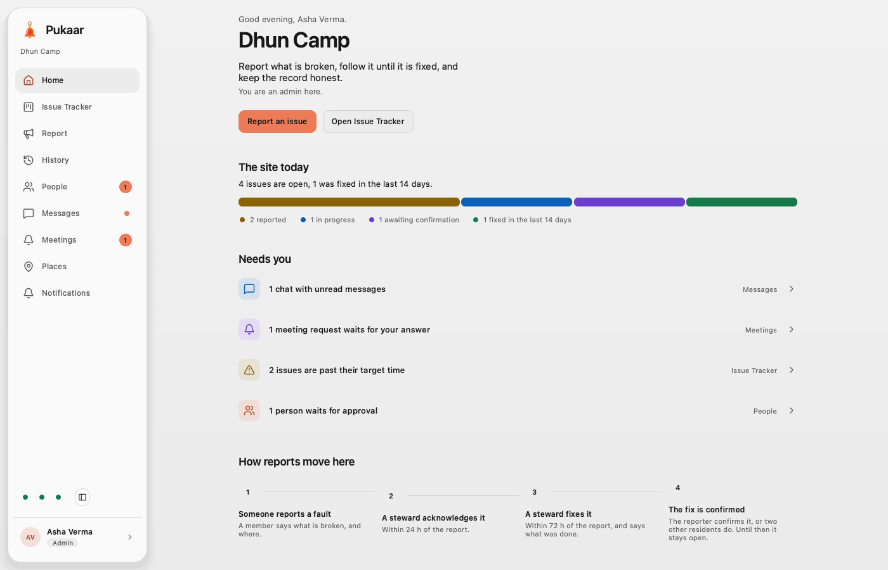

The first page after you open a site, here for the admin. It greets you, names the site and says what Pukaar is for. "The site today" counts the open issues by stage and the ones fixed in the last 14 days. "Needs you" lists what waits for you, each with a link: unread chats, meeting requests, issues past their target time and, for the admin, people waiting for approval. "How reports move here" shows the four steps from a report to a confirmed fix.

## The Issue Tracker

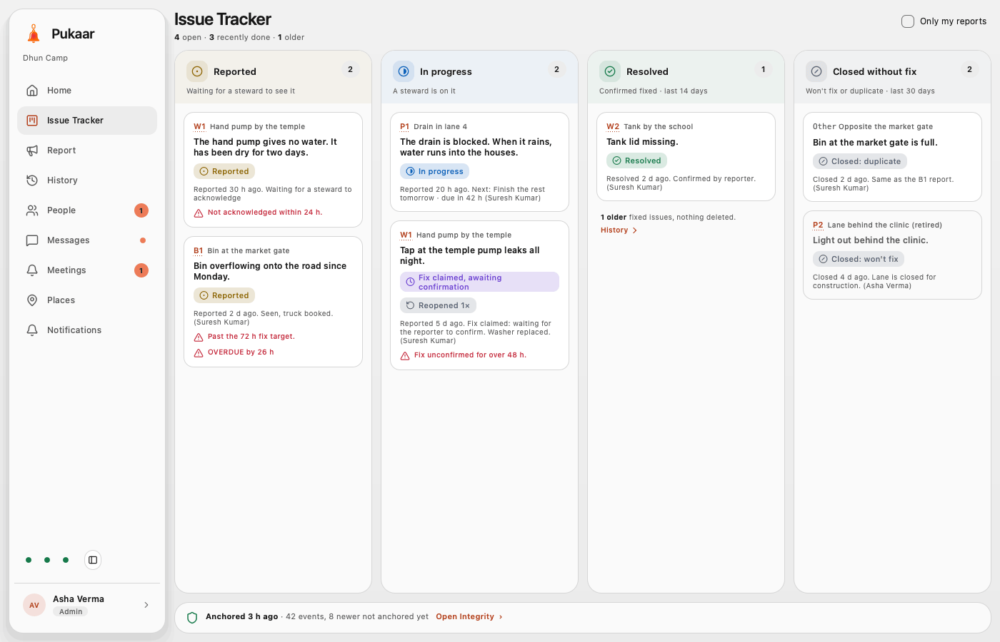

The Issue Tracker (the page that was called Board) for the sample site, seen by the admin, with four columns: reported, in progress, resolved and closed without fix. Cards that no steward acknowledged within 24 h, or that are past their target, are marked in red, so a stalled report is visible to everyone. The "Fix claimed, awaiting confirmation" card is still in progress, not resolved. The strip at the foot shows the last anchor and opens Integrity. The sidebar is the same for every member: Home, Issue Tracker, Report, History, People, Messages, Meetings, Places and Notifications. People shows a count of people waiting for the admin, Messages shows a dot for unread chats and Meetings shows a count of requests. Its foot shows three status dots (Delivery, Chain and Storage) and the "you" block that opens Profile. When the site record does not match its last anchor, a red banner shows at the top.

## Why a report isn't closed yet

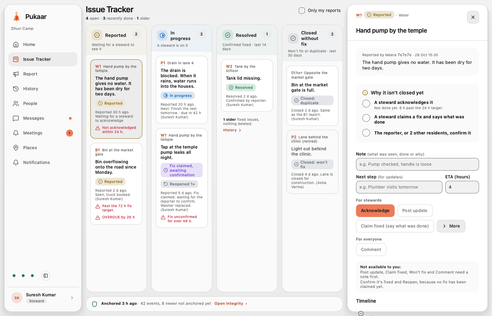

A new report, opened by a steward. The "Why it isn't closed yet" card lists three steps: a steward acknowledges, a steward claims a fix and says what was done, then the reporter or two other residents confirm. The actions sit right under the card. Won't fix and Mark duplicate are under More, and each asks for confirmation first. A box under the buttons says why the disabled ones are not available yet. The timeline comes last.

## Confirm or reopen a fix

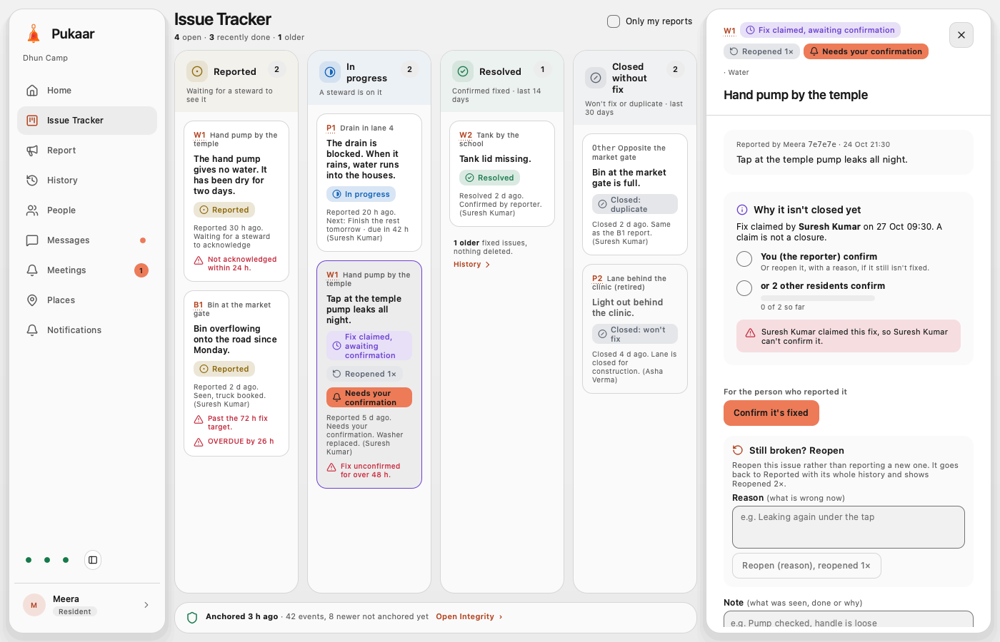

The same pane for the reporter, on a fix a steward has claimed. A claim is not a closure: the card says who still has to act, the reporter or two other residents, and never the person who claimed the fix. "Still broken? Reopen" has its own reason box, apart from the note for comments.

## History

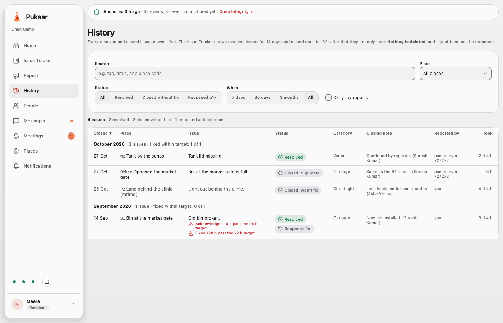

A table of every resolved and closed issue, with search and filters for place, status and time, grouped by month with how many were fixed within target. On a narrow window or beside the issue pane, the last four columns drop out. The Issue Tracker shows resolved issues for 14 days and closed ones for 30. After that they live here. Nothing is deleted, and any issue can be reopened. A status strip at the top shows the last anchor and opens Integrity.

## Report a fault

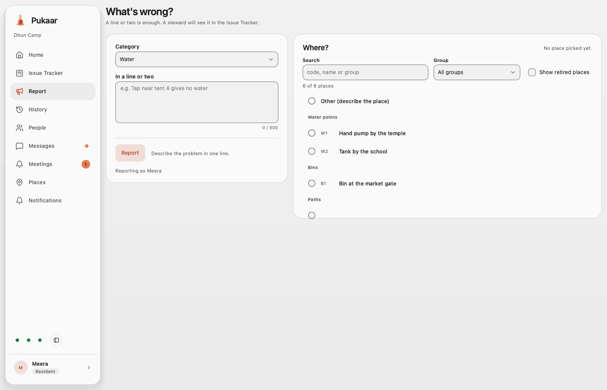

The report form: a category, a line or two of description, and a place from the site's grouped, searchable list, or "Other" with a description. The list scrolls inside its panel. Next to the Report button, the form says what is still missing.

## Messages

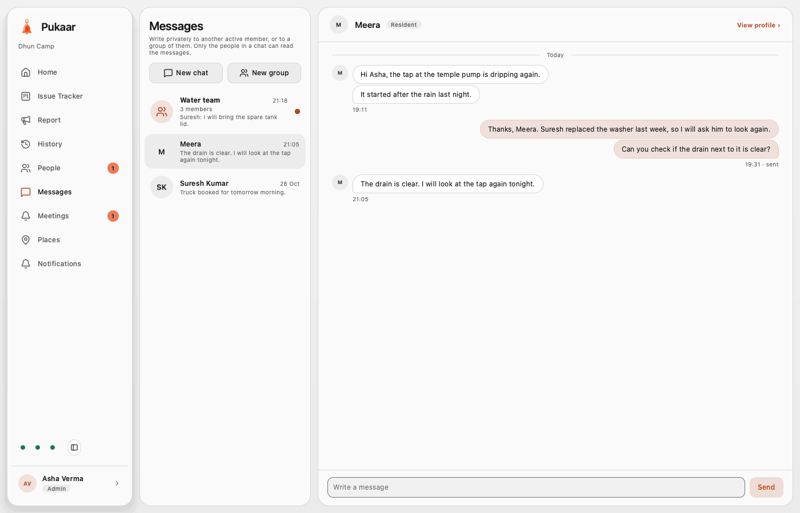

Private chat between two members. The chat list on the left shows each chat with a preview and a time, and a dot on a chat with unread messages. New chat and New group start a chat. The open chat shows the other person's name and role, with "View profile". Your messages sit on the right, theirs on the left, and the time shows once under each run of messages. Only the people in a chat can read it.

## Group chat

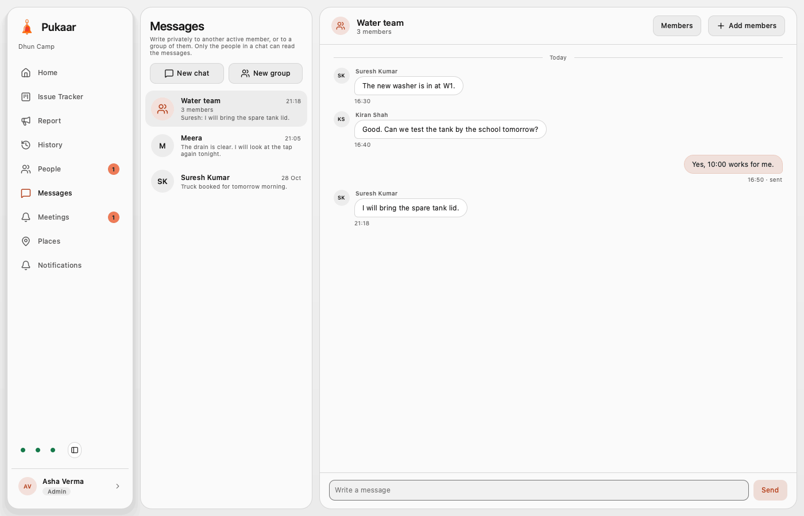

A group chat. The header shows the group name and its member count, with Members and Add members. Each message from someone else shows who wrote it. A member who joins a group later does not see the earlier messages.

## Meetings

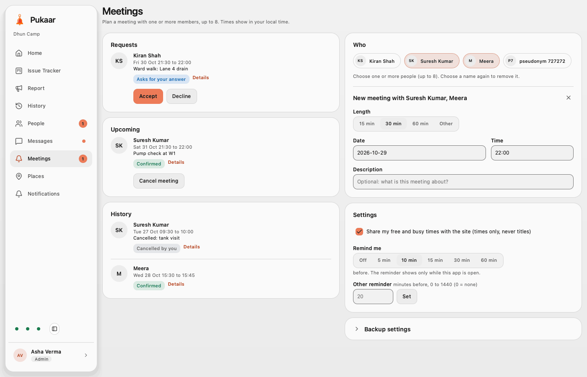

Meetings, here with a new meeting for two people open. Requests waiting for your answer come first, with Accept and Decline, then upcoming meetings and the history. Under Who you pick one to eight members. The new meeting form takes a length, a date and a time. For you and for each person, it says if they are free at that time. It also says when each person is busy that day. A description is optional. Settings hold the free and busy sharing switch and the reminder time.

## Meeting backup

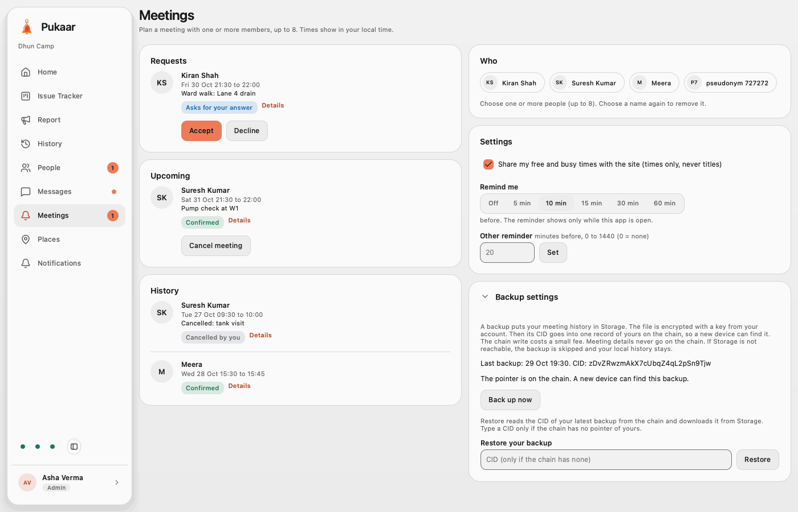

Backup settings on the Meetings page, opened. A backup puts your meeting history in Logos Storage, encrypted with a key from your account. Then it writes its CID to one record of yours on the chain. The panel shows the last backup and its CID, and says the pointer is on the chain, so a new device can find it. "Back up now" makes a new backup, and Restore reads the latest one back.

## People

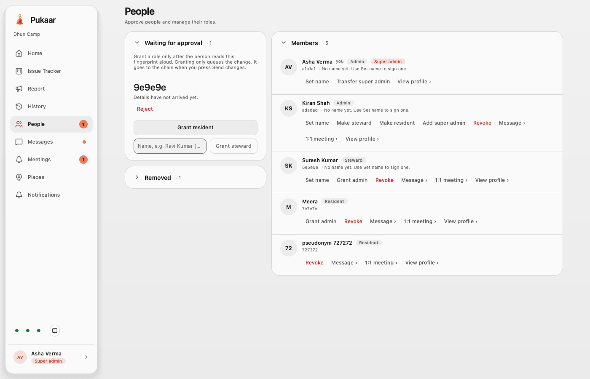

Every member sees People: each member's role, with staff named and residents named or shown as "pseudonym" and their code, and "Removed" (collapsed here), which says who removed each person, when and why. Residents and stewards see it read-only. Admins approve people after they read their code aloud. A grant only queues the change. When the admin presses Send changes, it goes to the chain. This is the super admin's view. The site creator's key is the first super admin, and a site has at most two. Only a super admin can grant or change admins. A super admin can transfer the role, or move an admin to steward or remove them after a notice. Each row also has Message, 1:1 meeting and View profile.

## Member profile

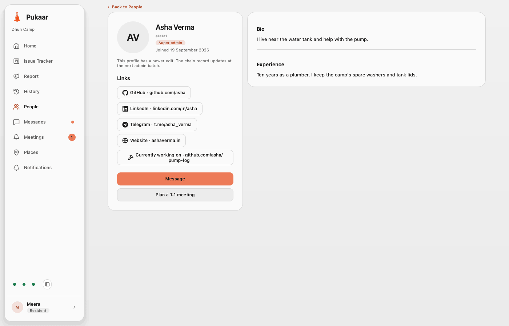

A row in People opens that member's profile, here the super admin as a resident sees it. It shows their name, code, role and join date, their links (GitHub, LinkedIn, Telegram, Website and "Currently working on"), their bio and their experience. A link asks before it opens in the browser. Message and "Plan a 1:1 meeting" sit under the links. A member who turned off sharing shows only their name and role.

## Places

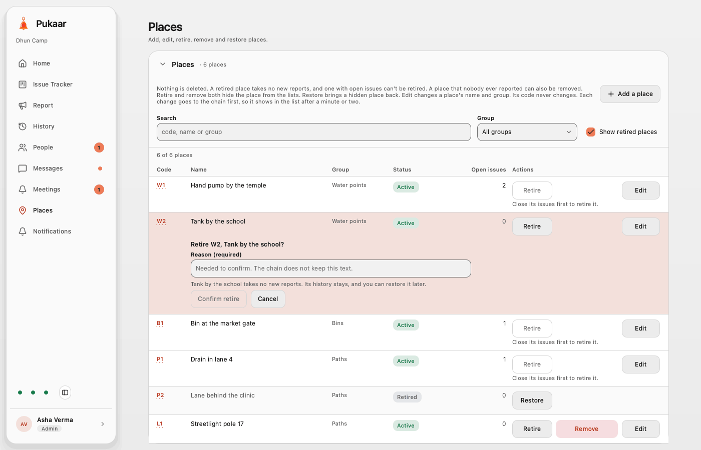

Every member sees Places as a table: each place's code (a link to that place in History), name, group, status and open issues, with search and a group filter. This is the admin's view with "Show retired places" on and the retire step open on one place. The admin also gets "Add a place" and Edit, Retire, Remove and Restore on each place. A place with open issues cannot be retired, and only a place that nobody ever reported can be removed. Each action asks for a reason in a confirm step. It goes to the chain first, so it shows in the list after a minute or two.

## Profile

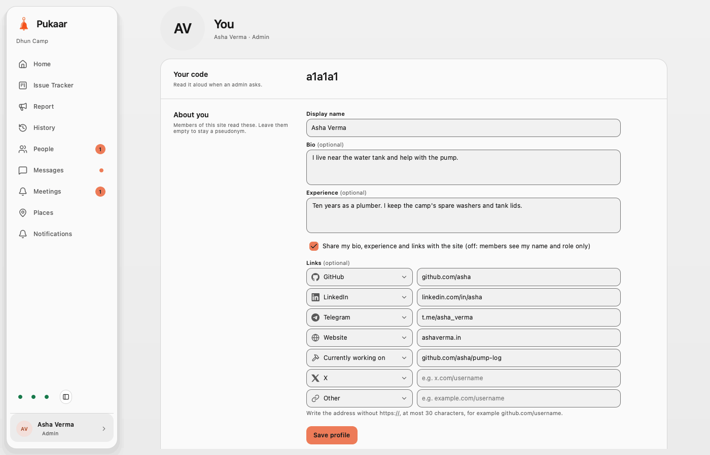

The "you" block at the foot of the sidebar opens Profile. It starts with your code to read aloud. Then "About you" holds your display name, a bio and your experience (up to 400 characters each). A switch shares them with the site, and you can add up to seven links. Each link row has a type (GitHub, X, LinkedIn, Telegram, Website, "Currently working on" or Other) and an address of at most 30 characters.

## Identity backup and invite

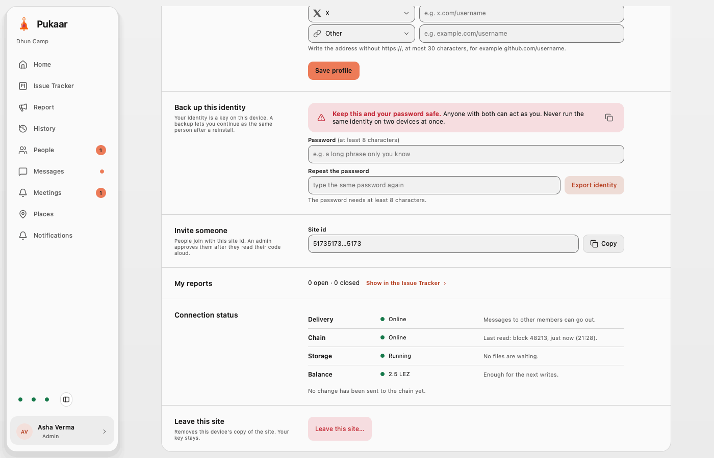

Further down Profile is a password-sealed backup of your identity and the site id to invite someone. Next come a count of your reports, which opens them in the Issue Tracker, and Connection status. Connection status says in words what the three sidebar dots show for Delivery, Chain and Storage, and gives the balance of your network account. "Leave this site" comes last, with a confirm step.

## Integrity

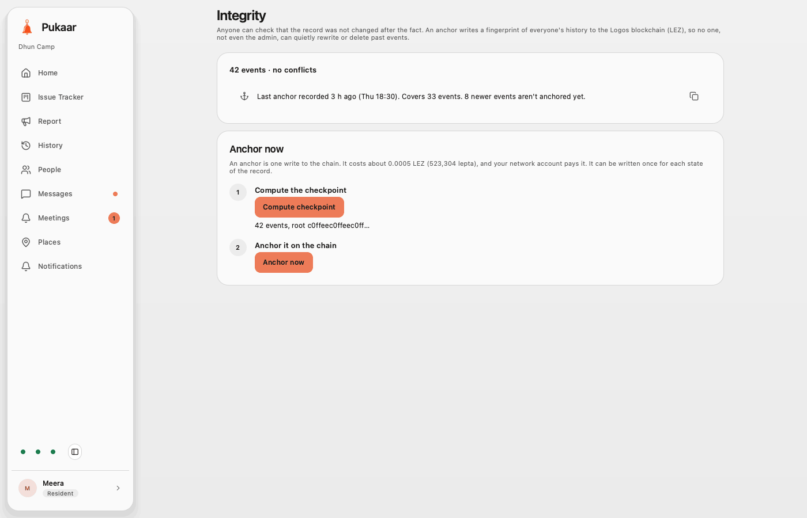

The strip on the Issue Tracker and History opens this page. The sidebar has no Integrity entry. The status block counts the events and conflicts and reports the newest anchor recorded in the site's history: when it was recorded and how many events it covers. If the site was never anchored, or the last anchor is older than 24 hours, it shows a warning. If the record on this device does not match the anchor, it turns red. It never says "verified", because the app does not read LEZ. Any member can anchor in two steps: compute the checkpoint, then "Anchor now", which writes the checkpoint to the chain. The page says what that costs, and your network account pays it.

## Render the screenshots

<details>
<summary>Render the screenshots in detail</summary>

`scripts/ui-shots.sh` renders the Pukaar view offscreen against the fixture data in `scripts/ui-shots.qml`. It needs Nix at `/nix/var/nix/profiles/default/bin/nix`, and Nix gets the Qt 6.9.2 that `logos-module-builder` uses. The script renders the light and dark themes at 800, 1280 and 1400 px. It shows each state (not in a site, pending, resident, steward, admin and super admin), each page, the issue pane, chats, meetings and member profiles. It prints each QML warning. When there is a warning, the script exits with a non-zero status.

```bash
scripts/ui-shots.sh              # writes to $TMPDIR/pukaar-shots/<git short hash>
scripts/ui-shots.sh <out dir>
```

The README images are the 1400 px shots, from the `light` folder for `NN-name.png` and the `dark` folder for `NN-name-dark.png`: `admin-board`, `steward-issue-new`, `resident-issue`, `resident-history`, `resident-report`, `admin-profile`, `superadmin-people`, `admin-places-rows`, `resident-proof`, `admin-messages-dm`, `admin-meet-meetings-new`, `admin-profile-backup`, `resident-member-admin`, `admin-home`, `admin-messages-group` and `admin-meet-meetings`, in that order.

To compare two runs, you need ImageMagick. Use the `magick compare` loop in the header comment of `scripts/ui-shots.sh`.

</details>
